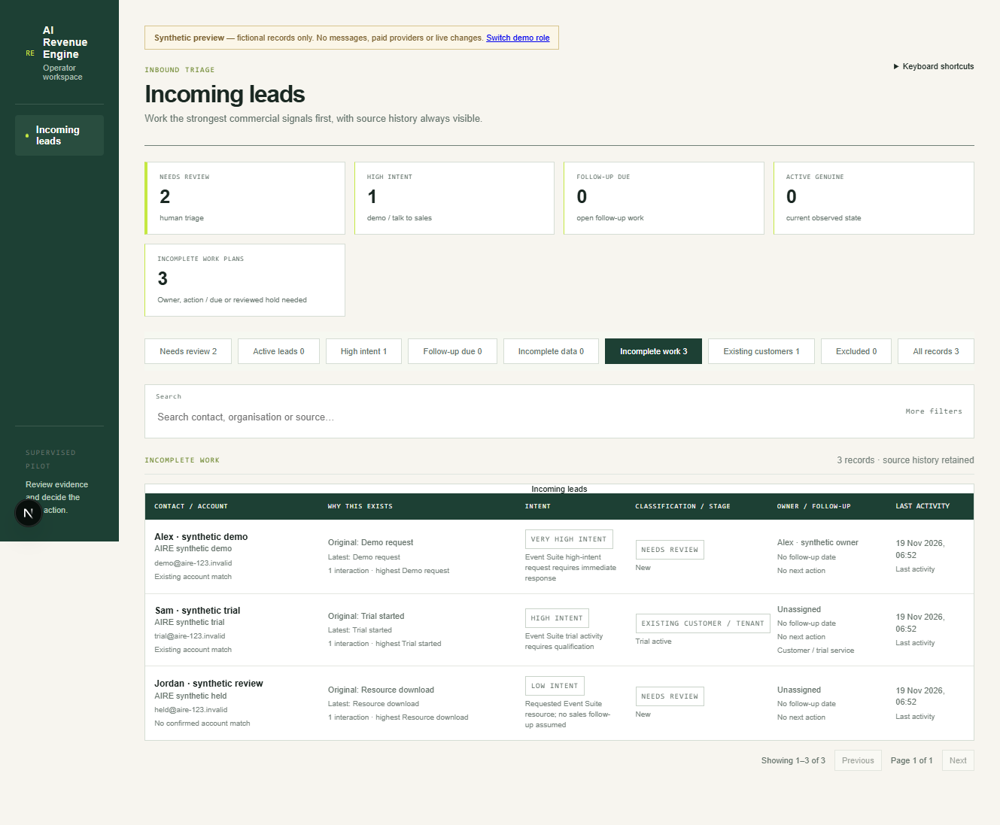
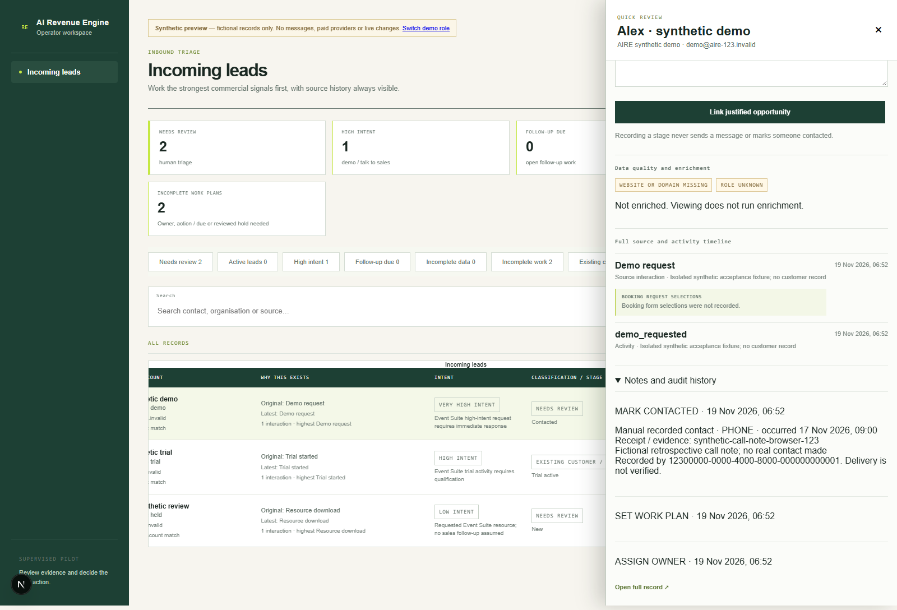

# AIRE #123: bounded accountability and manual-contact correction

19 November 2026. Source correction against merged PR #124 / main `050e119206cf239bc06706dd3a697a29de473bc5`, implementing only [Leo's two review concerns](https://github.com/raphaeldomalik-eng/Prestige-Architecture/issues/32#issuecomment-6976260453). Original AIRE epoch-1 writer continues under the sole portfolio PM; no parallel register or operational owner.

Status: **IMPLEMENTED AND VERIFIED IN ISOLATION; NOT LIVE / NOT COMMERCIAL OR PRODUCTION ACCEPTANCE.**

## Accountability without breaking compatibility

`ASSIGN_OWNER`, `SET_NEXT_ACTION`, `SET_FOLLOW_UP` and the existing bulk owner assignment remain supported. A new database-filtered **Incomplete work** queue and **Incomplete work plans** metric include every open non-test `NEEDS_REVIEW`, `GENUINE_PROSPECT` or `EXISTING_CUSTOMER` record lacking:

- an active operator/admin owner; or
- a nonblank next action and follow-up date, unless a complete reviewed hold supplies its review condition/date.

Inactive owners, whitespace actions and cleared due dates cannot disappear behind a superficially assigned owner. Customer/trial service work is included. Excluded/test and terminal converted/disqualified/lost work are excluded. A reviewed hold can replace action/due requirements but does not replace ownership. Releasing that hold exposes any remaining incomplete plan.

Queue and metric use the same predicate. A private read-only eligibility helper checks the authenticated caller is an active revenue member and returns only an owner's eligibility boolean. It is needed because existing membership-table RLS reveals only the caller's membership; it does not broaden table visibility. Fixed search path and authenticated-only function grants remain explicit. Existing public RPC signatures, operator mutation checks, row locks and bulk action allowlist remain unchanged.

## Contact evidence rather than an invented timestamp

Legacy `MARK_CONTACTED` now requires all of:

```json
{
  "contactedAt": "2026-11-17T09:00:00Z",
  "channel": "PHONE",
  "evidenceReference": "synthetic-call-note-123",
  "summary": "Fictional retrospective discussion; no real recipient"
}
```

Channels: `PHONE`, `IN_PERSON`, `VIDEO`, `EMAIL` (a previously sent external email, never a send command). Missing/blank evidence, unsupported channels, malformed/nonfinite/future timestamps and overlong references/summaries are rejected before mutation/audit. The authenticated actor and database save time are retained separately from the supplied occurrence time. `last_contacted_at` uses the latest actual recorded occurrence; backdated evidence cannot move it backwards.

The existing immutable change ledger stores `contactEvidence.kind=MANUAL_RECORDED`, occurrence/channel/reference/summary/actor and `deliveryVerified=false`. This is an operator attestation backed by a reference for review, not automatic independent verification that an external interaction happened or that an email was delivered. No inbound or delivered activity is fabricated. Existing historical marks and notes are retained, with unsupported old marks labelled as having no evidence captured in that audit entry. No historical timestamp is rewritten by the migration.

The existing hold, customer/trial, linked-opportunity and viewer restrictions continue to apply. Bulk `MARK_CONTACTED` remains denied. Opportunity stage recording alone still never sets a contact timestamp. The drawer/full-record audit displays the manual evidence and unverified-delivery label; the manual-entry form is read-only for viewers.

## Focused acceptance and reused evidence

- Both original gaps were reproduced RED in the real local PostgreSQL/WASM harness: an assigned-but-partial plan was absent from the requested queue, and evidence-free `MARK_CONTACTED` succeeded. Corrected assertions pass.
- Scoped SQL: **5/5 PASS**, including the existing three workflow cases plus new accountability and manual-contact cases. Added cases exercise individual/bulk paths, whitespace/cleared fields, reviewed hold/release, inactive and different active owners under RLS, unchanged membership visibility, anonymous helper denial, evidence rejection with no state/audit mutation, occurrence time/monotonic history, and viewer/bulk denial.
- Required `npm run check`: **exit 0** — typecheck, lint, **1,101 tests passed / 1 skipped / 0 failed**, build and replay packaging PASS. The existing Next ESLint-plugin detection warning is unchanged and non-failing. No duplicate full gate was commissioned.
- Changed-path browser → API → actual isolated database → audit → reload: **1/1 PASS**, 17.0s test / 18.8s runner. An API-created partial legacy plan is visible in the queue/metric; the UI completes it; evidence-free contact returns 400; manual contact saves the stated past time, retained receipt and `deliveryVerified=false`; reload preserves it; viewer write returns 403; external browser requests **0**. A first browser attempt saved correctly but opened the audit before the drawer finished refreshing; the test now waits for that evidenced refresh, without a product-code workaround.
- One existing read-only reviewer found no important defect. Its noted preview-migration limitation is handled with `--fresh`, not an unrelated runner redesign. React labels, disabled viewer controls, safe text rendering and existing component boundaries were checked without a refactor or new dependency.
- Original accepted #124 classification/opportunity/replay/service/hold evidence remains the source for unchanged scenarios; it was not repeated as another audit. No claim that the historical 88 leads are assigned, contacted or changed.





[Captured synthetic API/audit state](aire-123-correction/state.json) retains the occurrence time, actor, manual evidence and single original inbound activity. Capture was read-only, with zero external browser requests.

## Reproduce locally

```powershell
node scripts/lead-preview/start.mjs --fresh
node --test --experimental-strip-types tests/incoming-lead-accountability-sql.test.ts tests/incoming-lead-workflow-sql.test.ts
node node_modules/@playwright/test/cli.js test --config=playwright.leads.config.ts lead-accountability-preview.spec.ts
```

Open `http://127.0.0.1:3123/lead-preview`. The launcher strips application/provider credentials and serves loopback only. **Use `--fresh`:** old persisted preview databases deliberately skip setup once their tables exist and do not apply the added migration. A fresh run preserves decisions across reloads within its own synthetic database; it never changes the earlier preview or customer records. No browser response mocks or provider calls are used.

## Protected release boundaries

New forward-only source migration: `20261119064444_incoming_lead_accountability_contact_evidence.sql`, SHA-256 `5505c511f325118ba04550a485bf8a3df77ec2d878e9eb62b9c3b92b0586bd0a`. It replaces functions only, without a data backfill. Original merged `20261117192332_incoming_lead_workflow.sql` remains unchanged; any eventual target must be reconciled for both, not assume either is hosted-applied. No SQL was applied to a hosted database.

Remaining independent gates: Sales Director's own commercial ratification in Architecture #32; documented closure of historical PR #28 service-key/affected-session clearance before live authentication; authorised synthetic target/role acceptance; exact reviewed migration/source/target/ledger/recovery packet and separately authorised application promotion/Production operation. Main automatic deployment remains disabled. The new PR is source review only; it does not inherit #124's already-consumed exact source-merge approval.

No sending/test send, campaign, live lead/customer operation, pricing change, paid provider, canonical identity/publication change, enrichment worker or monitor activation. Nexus draft PR #136 and ENR16-ACCEPTANCE-HOLD remain untouched. No further source correction is evidenced within these two concerns; stop after this bounded acceptance and return the one reviewable PR.
