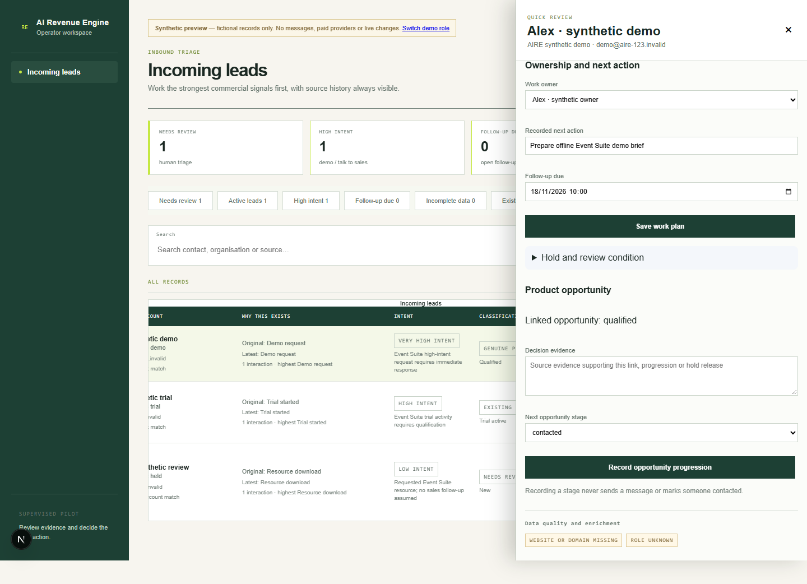

# AIRE #123 isolated lead-management preview

This slice extends the existing Incoming Leads workspace and `update_incoming_lead` RPC. It adds no CRM, provider integration, customer-state writer or enrichment path. Authority is the owner's resume instruction and Leo's provisional commercial contract in [Architecture #32](https://github.com/raphaeldomalik-eng/Prestige-Architecture/issues/32#issuecomment-6955135181). Sales Director ratification is still required for commercial functional acceptance; this is not a Production release.

## Run and isolation

From this repository, after `npm ci`:

```powershell
node scripts/lead-preview/start.mjs
```

Open [the local preview](http://127.0.0.1:3123/lead-preview). Choose the fictional operator or read-only viewer. Demo roles are explicitly synthetic; this is not proof of live Supabase authentication or credential rotation.

The launcher passes only OS/runtime essentials to Next, supplies a random signing key and binds to loopback. The adapter refuses Vercel/live-provider configuration. A preview-only middleware allowlist blocks every unrelated application/provider/cron endpoint. Its content policy blocks inherited remote fonts and other external browser resources. Normal application authentication is unchanged when preview mode is off, and `/lead-preview` returns 404.

PostgreSQL/WASM uses the existing PGlite dependency and checked-in AIRE schema, intake, identity, immutable-submission, replay, queue, audit and permission functions. It stores only three fixed fictional `.invalid` fixtures under ignored `scratch/`. No hosted database or customer record is read, copied or changed. The source adapter represents production-style source fields solely inside this separate local fixture database so the real eligibility/RPC path is exercised; it never sends a fixture to EventSuite or Supabase. No application credentials are needed or loaded.

`--fresh` creates a new synthetic database directory without deleting any prior evidence. The default launch reuses the default database. Preview build files use `.next-lead-preview` so the normal build cannot overwrite an active preview.

## Completed flow

- A high-intent synthetic demo starts in `NEEDS_REVIEW` and the unassigned queue. The operator supplies evidence before marking it genuine.
- One work-plan operation records an eligible operator/admin owner, next action and due date atomically.
- Explicit opportunity linking requires a reviewed genuine prospect, resolved account/contact/product, complete work plan and no active hold. Existing matching opportunities require deliberate selection; account locking prevents concurrent duplicate creation. Retries retain one opportunity.
- Opportunity progression uses explicit permitted transitions and evidence. The existing audit ledger retains actor, timestamp, previous lead/opportunity and updated lead/opportunity. A recorded stage never sends a message, changes product customer state or automatically sets a contacted timestamp.
- Trial/customer follow-up remains a distinct service path. Trial source/stage cannot acquire a new-sales opportunity by reclassification alone.
- Ambiguous identity remains reviewable with a hold reason, review condition and review date. Holds prevent legacy progression bypasses. Due work includes customer follow-ups and due hold reviews.
- The list retains source, classification/stage, owner, action/date and hold context. All-record totals count leads, not source submissions. Viewer and unauthenticated writes are denied.

The initial read-only 88-lead baseline is retained in [the intake ACK](https://github.com/raphaeldomalik-eng/ai-revenue-engine/issues/123#issuecomment-6954172503); it was not re-audited or mutated for this implementation.

## Focused acceptance

```powershell
node --test --test-isolation=none --experimental-strip-types tests/incoming-lead-workflow-sql.test.ts
npx playwright test --config playwright.leads.config.ts
npm run check
```

Browser acceptance expects a fresh fixture database: start with `--fresh` before running it. The test uses installed Chrome and the actual local API/RPC/database, with no response mocks. It covers prospect review/plan/link/progression/audit/reload, replay without duplicate lead/activity, trial service, ambiguous hold, unassigned queue, viewer and unauthenticated denial, unrelated endpoint denial and zero external browser requests. SQL acceptance additionally covers direct authenticated table-write denial, invalid progression, trial reclassification bypass, legacy hold bypass and prior opportunity audit state.

The read-only reviewer identified the legacy progression bypass, trial reclassification bypass and missing prior opportunity state. Each was reproduced and corrected in this same branch, with regression coverage. No second implementer or coding lease was introduced.

Screenshots and final command results are linked from #123 and the implementation PR. Do not use an automatically generated hosted PR deployment as the isolated acceptance environment: the verified preview is the loopback process above.

Recorded results, 17 November 2026: scoped SQL integration **3/3 passed**; focused browser acceptance **1/1 passed** (21.1 seconds including setup); final repository gate **exit 0**, **1,099 passing / 0 failing / 1 skipped**, typecheck, lint, build and replay packaging passed. The final display-only status-message addition also passed a fresh typecheck and read-only browser rendering. The independent review's three findings are resolved by the SQL regression cases; there are no unresolved review findings for this preview slice.



[Retained source and audit](aire-123-preview/audit.png) · [Ambiguous hold and review condition](aire-123-preview/held.png) · [Unassigned queue](aire-123-preview/unassigned.png)

## Remaining release boundaries

The forward migration is checked in and exercised only locally. It has not been applied to any hosted database. Protected live-auth, exact target release authority and Sales Director commercial acceptance remain separate. No production recommendation, outreach, campaigns, queue activation, paid providers, enrichment changes or live data remediation is included.
