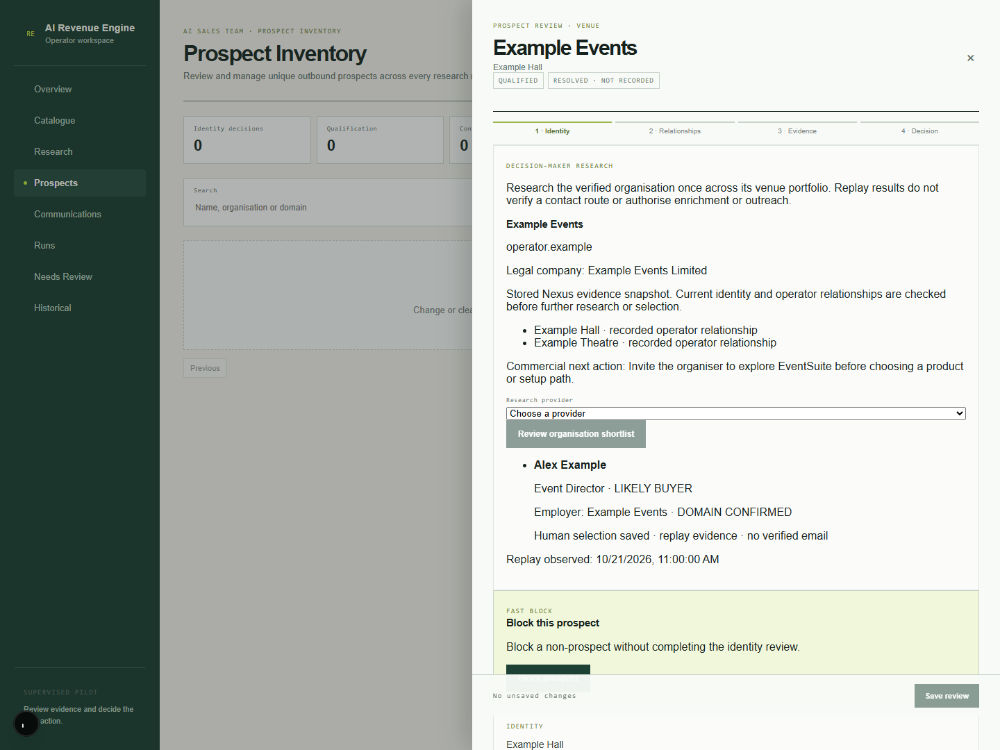

# Option 1: minimal compatibility alignment

The approved journey is implemented without Option 2 consolidation. Nexus remains the canonical identity owner; AIRE retains commercial and workflow state. This change is isolated from AIRE #79 and Nexus #58.

## State preservation

The legacy company research route now reuses an existing account, contact and account/product opportunity without updating their commercial fields. Fresh findings remain in the existing evidence and AI Sales Brief history. Verified contact details, provenance, suppression, ownership, opportunity stage, conversion decisions and custom metadata survive repeated refreshes. New records retain the existing creation behaviour; research does not mark a new contact verified.

## Connected journey and reused components

The existing contact-research endpoint and prospect drawer expose explicit link, search, select and read actions. A prospect outside the current inventory filter opens through the existing prospect-detail API.

1. An operator links an existing account to an existing, active Nexus organisation. The read-only Nexus reader checks the organisation name and official domain against the resolved commercial account. Venue-first candidates additionally require an existing Nexus operator relationship. Legal company references and venue IDs remain separate from the organisation UUID and individual people.
2. The drawer displays the existing `prospect_intelligence` commercial assessment. It does not introduce another Lead Intelligence, Prospect Intelligence, Sales Brief or opportunity scorer.
3. The operator explicitly chooses **Apollo replay (no paid calls)**. `searchPrimaryApolloBuyers` reuses the existing contact eligibility gate, primary role families, employer/domain verification, normalisation and role ranking. Its injected transport returns only a server-configured replay; no live fallback, Apollo key, person enrichment or email lookup is available in this workflow.
4. The operator selects an accepted, domain-confirmed person from the server-held shortlist. A forged person ID, stale revision or expired evidence is rejected. Selection is bound to the replay fingerprint, so changed evidence requires a fresh selection.
5. The shortlist and selection are saved once per Nexus organisation and reused across its linked venues/accounts. The saved record explicitly has no verified-email, enrichment or outreach authority. Identical replay evidence does not repeat the search/persistence cycle.

The minimal account cross-reference is `accounts.metadata.nexusResearchReference`, including the Nexus organisation UUID, evidence references and actor/time. A compare-and-swap update preserves other metadata and rejects concurrent changes. Existing canonical, account, candidate, venue and contact IDs are retained. No inventory migration or Nexus write occurs.

## Persistence and controls

`20261021195305_option1_organisation_contact_intelligence.sql` adds one AIRE-local table, keyed by an existing Nexus organisation UUID. Internal-member RLS applies: active viewers read; operators/admins write with their own actor ID. Canonical keys and creator fields cannot be updated by authenticated clients. Revision checks prevent lost updates; shape/size constraints reject invalid identities and selections that imply enrichment or outreach authority.

The migration has **not been applied to a remote database**. No activation flags, provider keys or deployment settings were changed. The route remains disabled by default and additionally rejects production even if its existing pilot flags are set. No communications, queues, crawling, publication, person enrichment, bulk migration or paid provider request was executed.

For a separately authorised non-production pilot, the existing two contact pilot/persistence flags, the additive migration, authenticated internal membership and read-only Nexus database access are prerequisites. `AIRE_CONTACT_RESEARCH_REPLAY_FILE` must point to a trusted server-local JSON file with `nexusOrganisationId`, `domain`, `observedAt` and `people`; request bodies cannot supply the file path or replay. The synthetic example is `tests/fixtures/option1-apollo-replay.json`. Replay evidence must match the selected organisation/domain, contain at most 100 people and be no older than 30 days. A missing or invalid configuration fails closed. This document records prerequisites, not permission to activate them.

## Acceptance evidence

- `npm run check`: **passed** (typecheck, lint, 770 tests passed / 1 skipped / 0 failed, Next production build). An inherited preload removed credential environment variables and denied outbound fetch/HTTP/TCP throughout the gate. One existing dry-run harness transient failed in an earlier parallel run; its dry-run artifact, isolated test and subsequent full gate passed without changing that harness.
- Focused service/store/HTTP/state tests cover repeated refresh, shared two-venue context, eligibility, identity conflicts, replay freshness/binding, forged/stale selection, changed-role selection history, concurrent updates and production/default holds. A separate corpus regression proves a candidate without an account causes no persistence or replay load.
- `npx playwright test --config playwright.option1.config.ts`: **1 passed**. Real local Next UI and actual research HTTP/service/Supabase adapter; synthetic authentication, canonical identity, database transport and Apollo replay. Non-local browser requests are aborted. The real unconfigured API is also checked to return 503. Link → commercial assessment → explicit provider → ranked shortlist → human selection → reload succeeds with the candidate absent from the filtered inventory.
- Local PGlite/PostgreSQL migration proof: **19 passed**. Actual DDL, RLS roles, grants, immutable IDs, viewer/nonmember/anonymous restrictions, invalid JSON/null authority fields, revision compare-and-swap and JSONB metadata equality. Existing membership helpers are stubbed with matching active-role semantics; this is not hosted Supabase or PostgREST integration. Reproduce from the repository root with `node docs/delivery/option1-minimal-compatibility/postgres-proof.mjs <preinstalled-PGlite-entrypoint>`; no dependency install or remote database is needed. The acceptance run used the already-installed sibling Nexus PGlite package.
- Independent read-only review found two edge cases (filtered deep links and stale selection labels); both were reproduced, fixed and confirmed with **17/17 focused tests passing**.

## Limits and next action

Post-merge hosted preparation exposed a packaging defect: the dynamically configured replay file was absent from the generated contact-research function trace. The narrow correction explicitly includes only the synthetic fixture for that route. `scripts/check-option1-replay-bundle.mjs` checks the generated deployment manifest and reads the traced file during every normal build. This check failed before the correction and passed afterward; the complete offline check gate also passed (770 passed, one skipped). This uses Next.js [file tracing includes](https://nextjs.org/docs/15/app/api-reference/config/next-config-js/output) and does not activate a provider or change production gates.

This is locally verified replay delivery, not a production deployment or a live Apollo acceptance. No hosted migration, real-user login, production Nexus lookup or paid provider was exercised. The next action is to review this implementation PR and its working replay journey. Live provider enablement, budgets and production rollout remain separate subsequent product decisions; none is needed to review Option 1. No Option 2 consolidation is proposed.
